# ⚡ Pokébourse

**Plateforme locale d'aide à la décision, d'identification et d'arbitrage d'achat-revente de cartes Pokémon.**

[](https://www.python.org/)
[](https://fastapi.tiangolo.com/)
[](https://www.sqlite.org/)
[](https://docs.docker.com/compose/)
[](extension/README.md)
[-brightgreen)](tests/)
[](app/storage/migrations/)
[](#-éthique-législation--respect-des-plateformes)

---

Pokébourse analyse le marché secondaire (Vinted, Leboncoin, eBay, Wallapop, captures d'extension, imports JSONL), rapproche formellement chaque offre du référentiel officiel **TCGdex**, et calcule la **rentabilité nette exacte** d'arbitrage en appliquant les cotes réelles de marché (**Cardmarket**, ventes réussies), les commissions de plateforme et les frais d'expédition au centime près.

Conçu pour fonctionner **100 % en local**, sans serveur cloud, sans abonnement tiers et sans dépendance frontend externe.

---

## 📑 Sommaire

1. [🎯 Pourquoi Pokébourse ?](#-pourquoi-pokébourse-)
2. [⚡ Démarrage Rapide (60 secondes)](#-démarrage-rapide-en-60-secondes)
3. [🧭 Visite Guidée & Fonctionnalités](#-visite-guidée--fonctionnalités)
   - [0. Le parcours utilisateur : Capturer → Décider → Suivre](#0-le-parcours-utilisateur--capturer--décider--suivre)
   - [1. Tableau de bord principal](#1-tableau-de-bord-principal)
   - [2. Extension Chrome — Pokébourse Capture](#2-extension-chrome--pokébourse-capture-manifest-v3)
   - [3. Ajout d'annonces par URL & Imports JSONL](#3-ajout-dannonces--saisie-assistée-par-url--imports-jsonl)
   - [4. Catalogue & Identification TCGdex](#4-catalogue--identification-tcgdex-catalog)
   - [5. Recherche Avancée & Tris Financiers](#5-recherche-avancée-multi-critères--tris-financiers-search)
   - [6. Tendances de Marché & Activité des Annonces](#6-tendances-de-marché--activité-des-annonces-trends)
   - [7. Assistance Visuelle OCR & Cadrage Manuel](#7-assistance-visuelle-ocr-local--cadrage-manuel-t061)
   - [8. Fiche Détaillée & Preuves de Prix](#8-fiche-détaillée-preuves-de-prix--comparables-catalogid)
   - [9. Moteur de Rentabilité & Cotes Cardmarket](#9-moteur-de-rentabilité--réglages-financiers-reglages)
   - [10. Mes Achats & Suivi du Portefeuille](#10-mes-achats--suivi-du-portefeuille-achats)
   - [11. Annuaire des Vendeurs & CRM](#11-annuaire-des-vendeurs-pépites--crm-sellers)
   - [12. Validation Humaine & Pilote ML Phase 0](#12-validation-humaine--pilote-dannotation-ml-phase-0)
   - [13. Veilles Automatiques & Supervision](#13-veilles-automatiques--supervision-des-collecteurs-watches-agents)
   - [14. Sauvegardes & Restauration SQLite](#14-sauvegardes--restauration-sqlite-backups)
   - [15. Hub de Gestion Avancée & Suivi du Projet](#15-hub-de-gestion-avancée--suivi-du-projet-gestion-tasking)
4. [🏗️ Architecture & Principes Inviolables](#️-architecture-technique--principes-fondamentaux)
5. [📥 Formats d'Échange JSONL](#-formats-dimport-de-fichiers-jsonl)
6. [🛠️ Utilisation en Ligne de Commande (CLI)](#️-utilisation-en-ligne-de-commande-cli)
7. [🧪 Tests & Assurance Qualité](#-tests--assurance-qualité)
8. [⚖️ Éthique, Législation & Respect des Plateformes](#️-éthique-législation--respect-des-plateformes)
9. [🤖 Guide pour Développeurs & Agents IA](#-guide-pour-les-agents-dia--développeurs)

---

## 🎯 Pourquoi Pokébourse ?

L'achat-revente de cartes Pokémon sur le marché de l'occasion recèle de nombreux pièges :

| Défi courant | Réponse de Pokébourse |
|---|---|
| **Fausses opportunités** (carte achetée 15 € cotée 20 € générant en réalité une perte) | **Calcul financier net exact** : commissions plateforme, port aller/retour, toploader et enveloppe bulle déduits au centime près. |
| **Pièges des lots** (un lot de 50 cartes rattaché par erreur à la carte la plus chère) | **Règle absolue des lots** : un lot détecté n'est jamais rattaché arbitrairement à une carte unitaire. |
| **Erreurs d'arrondi** liées aux nombres flottants | **Précision entière obligatoire** : montants en centimes entiers et pourcentages en points de base (`bps`), sans `float`. |
| **Blocages anti-bot** (Cloudflare / DataDome sur Vinted, Leboncoin) | **Extension Chrome Manifest V3** capturant naturellement pendant vos sessions de navigation réelles. |
| **Perte de traçabilité** des investissements et gains réels | **Carnet d'achats complet** avec cycle de vie de la commande (`Commandé` → `Reçu` → `En vente` → `Vendu`) et prix de revente réel. |
| **Dépendance aux services cloud payants** | **100 % local et conteneurisé** : base SQLite en mode WAL, sauvegardes à chaud, OCR Tesseract local, zéro appel réseau externe non consenti. |

---

## ⚡ Démarrage Rapide en 60 secondes

### Prérequis
- [Docker](https://docs.docker.com/get-docker/) avec le plugin **Docker Compose**.
- Aucun environnement Python n'est requis sur la machine hôte : l'ensemble tourne dans des conteneurs isolés.

### 1. Cloner et démarrer
```bash
git clone <url-du-depot> pokebourse
cd pokebourse

docker compose up --build -d
```

### 2. Accéder aux services
- 🌐 **Interface Web principale** : [http://localhost:8000](http://localhost:8000)
- 🩺 **Healthcheck API** : [http://localhost:8000/health](http://localhost:8000/health)
- 📜 **Logs du worker de veille** : `docker compose logs -f worker`

### 3. Arrêter l'application en toute sécurité
```bash
docker compose down
```
> [!IMPORTANT]
> **Ne lancez jamais** `docker compose down -v` ou `down --volumes` : vos données, historiques d'achats et cotes sont préservés dans le volume persistant `pokemon-data`.

---

## 🧭 Visite Guidée & Fonctionnalités

```mermaid
flowchart LR
    subgraph Capture["1. Capture & Entrées"]
        Ext["Extension Chrome (MV3)"]
        URL["Saisie d'URL (/ajouter-annonce)"]
        JSONL["Import JSONL"]
        Watch["Veille Worker"]
    end

    subgraph Identification["2. Identification TCGdex"]
        Detector["Détecteur de preuves"]
        TCGdex["Catalogue TCGdex"]
        OCR["OCR local (Cadrage/Rotation)"]
        Decision["Statut : Identifiée / Ambiguë / Lot"]
    end

    subgraph Rentabilite["3. Analyse Financière"]
        CM["Cote Cardmarket"]
        Comps["Comparables & Médiane"]
        Fees["Profil de frais"]
        Math["Gain Net & ROI exacts"]
    end

    subgraph Action["4. Décision & Portefeuille"]
        Review["Validation humaine"]
        Catalog["Catalogue Opportunités"]
        Achats["Mes Achats (/achats)"]
        Trends["Tendances (/trends)"]
    end

    Capture --> Identification
    Identification --> Rentabilite
    Rentabilite --> Action
```



---

### 0. Le parcours utilisateur : Capturer → Décider → Suivre

L'interface est structurée pour une expérience quotidienne fluide en trois étapes :

1. **Capturer** : injection d'une annonce via l'extension Chrome en 1 clic, saisie d'URL d'annonce, import JSONL ou veille programmée.
2. **Décider** : examen de la fiche détaillée avec analyse financière nette, comparables réels, cote Cardmarket, assistance OCR et verdict d'arbitrage.
3. **Suivre** : bascule de l'annonce en achat dans le carnet de portefeuille, suivi des statuts de commande et constat du prix de vente effectif.

| Entrée | Contenu & Rôle | Route |
|---|---|---|
| **Accueil** | Tableau de bord synthétique, KPIs du marché, opportunités urgentes et activité | `/` |
| **Opportunités** | Catalogue complet, rentabilité nette, statuts d'identification et export CSV | `/catalog` |
| **Recherche** | Moteur plein texte indexé multi-critères, recherche externe et tris financiers | `/search` |
| **Tendances** | Évolution des cotes Cardmarket (7j/30j), volume d'activité et radar d'affaires | `/trends` |
| **Mes achats** | Suivi du portefeuille, cycle de commande, prix de revente réel et coûts par devise | `/achats` |
| **Réglages** | Profils de frais, seuils de ROI/gain, cotes manuelles et synchronisation Cardmarket | `/reglages` |
| **Gestion avancée** | Hub des modules d'administration (vendeurs, veilles, imports, TCGdex, ML, sauvegardes) | `/gestion` |
| **Suivi du projet** | Consultation en lecture seule des plans Markdown, dépendances et incidents | `/tasking` |

---

### 1. Tableau de bord principal

Le tableau de bord centralise en temps réel la météo du marché et l'état de votre instance locale :
- **KPIs immédiats** : nombre d'annonces surveillées, opportunités rentables qualifiées, cotes de référence actives et montant total investi.
- **Opportunités prioritaires** : cartes classées par gain net et ROI net décroissants.
- **Importation rapide JSONL** : glisser-déposer un fichier d'annonces pour analyse immédiate.
- **Historique & Journal des échecs** : transparence sur les fichiers ingérés et rapport d'erreurs téléchargeable.


---

### 2. Extension Chrome — Pokébourse Capture (Manifest V3)

Pour contourner légitimement les protections anti-bot (Cloudflare, DataDome) sans risque de blocage d'IP, Pokébourse intègre une extension Chrome officielle dans [`extension/`](extension/README.md) :

- **Capture au fil de la navigation** : détection automatique des annonces Pokémon sur Vinted, Leboncoin, eBay et boutiques TCG spécialisées.
- **Notification Toast discrète** : confirmation visuelle en haut à droite sans perturber votre navigation.
- **Prévisualisation avant enregistrement (`POST /previsualiser-capture`)** :
  - Sélection unitaire d'une annonce pour examen dans un nouvel onglet avant toute écriture en base.
  - Affichage de la provenance exacte de chaque donnée (extraite de la page, saisie, corrigée, manquante).
  - Proposition d'identification TCGdex et rentabilité indicative locale.
  - La langue de la carte n'est jamais supposée : elle peut être renseignée explicitement ou laissée **Inconnue** (`und`).
  - Déduplication stricte et préservation inviolable de `first_seen_at` lors de la confirmation.
- **Envoi par lot ou Export** : transfert en 1 clic vers `/imports`, export de fichier `.jsonl` horodaté ou copie dans le presse-papier.


> [!TIP]
> **Installation en 3 clics** :
> 1. Ouvrez `chrome://extensions/` dans Google Chrome et activez le **Mode développeur**.
> 2. Cliquez sur **Charger l'extension non empaquetée**.
> 3. Pointez sur le dossier `extension/` du dépôt. L'icône Pokébourse est prête !

---

### 3. Ajout d'annonces : Saisie Assistée par URL & Imports JSONL

Le menu **« Ajouter des annonces »** rassemble toutes les options d'ingestion :

- **Saisie par URL (`/ajouter-annonce`)** :
  - Support natif d'**eBay**, **Vinted**, **Leboncoin** et **Wallapop**.
  - **Analyse syntaxique locale** : reconnaissance de la plateforme et extraction de l'identifiant sans dépendance réseau.
  - **Pré-remplissage sécurisé sur allowlist** : téléchargement borné sur domaines autorisés (anti-SSRF strict, 10s timeout, HTML max 2 Mo) avec extraction JSON-LD / OpenGraph.
  - **Détection immédiate des doublons** : vérification sur `(source, external_id)` avec avertissement si déjà enregistrée.
  - **Pré-analyse indicative en lecture seule** : test des propositions d'identification et de rentabilité avant confirmation.
- **Importation par lot JSONL** : téléversement direct de fichiers d'annonces volumineux (`/imports`).
- **Gestion des rejets** : journal d'erreurs d'import détaillé avec export CSV des anomalies (`/imports/failures/report`).

---

### 4. Catalogue & Identification TCGdex (`/catalog`)

Le catalogue unifié rassemble toutes les annonces collectées et les confronte au catalogue officiel :

- **Recherche plein texte** : filtrage instantané par nom, numéro ou mots-clés du titre d'origine.
- **Verdicts d'arbitrage** : *Opportunité* (vert), *À surveiller* (jaune), *Non rentable* (rouge), *Sans cote* (gris).
- **Tris multi-critères** : gain net estimé, ROI en points de base, prix d'achat, fraîcheur ou fiabilité vendeur.
- **Export CSV conforme Excel** : encodage UTF-8 avec BOM, séparateur point-virgule et protection anti-injection de formules.


#### Les 4 Statuts d'Identification TCGdex :
1. 🟢 **Identifiée (`identified`)** : preuves concordantes avec une référence du catalogue officiel.
2. 🟡 **À vérifier (`ambiguous`)** : plusieurs cartes concordantes sans critère discriminant fort (ex: réédition sans numéro de série ou dénominateur absent). Le système s'abstient par prudence.
3. 🔵 **Lot / Coffret (`lot`)** : détection de termes de vrac, boosters, coffrets ou displays. **Règle absolue : aucun lot n'est jamais rattaché arbitrairement à une seule carte**.
4. ⚪ **Non identifiée (`unidentified`)** : libellé trop vague. Réexaminable à tout moment après synchronisation TCGdex.

---

### 5. Recherche Avancée Multi-Critères & Tris Financiers (`/search`)

Un moteur de recherche haute performance interrogeant la base locale sans appel réseau :

- **Portée ajustable** : Tout (cartes du référentiel et annonces de marché), Cartes officielles uniquement ou Annonces seules.
- **Filtres officiels** : série, extension, rareté officielle, année ou intervalle d'années de sortie.
- **Filtres de marché** : prix min/max (€), état, langue, variante, édition, organisme de certification (PSA, PCA, BGS, CGC, CollectAura) et note.
- **Tris de rentabilité avancés** : tri par **Gain net (décroissant)** et par **ROI (décroissant)** calculés fidèlement en mémoire avec pagination stable.
- **Recherche externe contrôlée (`external=1`)** : déclenchement volontaire d'une recherche externe vers TCGdex ou eBay (connecteur HTML borné), avec résilience locale totale en cas de coupure internet.

---

### 6. Tendances de Marché & Activité des Annonces (`/trends`)

L'espace **Tendances** analyse la dynamique économique du marché secondaire :

- **Variations officielles Cardmarket** :
  - Comparaison des moyennes officielles : `avg7` vs `avg30` (moyen terme) et `avg1` vs `avg7` (court terme).
  - Écarts chiffrés en centimes et points de base (`bps`), calculés par arrondi demi-supérieur (`ROUND_HALF_UP`).
- **Activité des annonces récentes** : nombre d'annonces observées par carte sur une fenêtre glissante de 7 ou 30 jours (distinction stricte entre annonces actives et volume de ventes conclues).
- **Radar des meilleures affaires** : annonces actives dégageant le gain net et le ROI les plus attractifs.
- **Pagination & décomptes stables** : navigation paginée (`?page=...`) avec décompte exact et stable des cartes analysées.

---

### 7. Assistance Visuelle OCR Local & Cadrage Manuel (T06.1)

Pour aider à identifier les cartes à partir de photos sans compromettre la vie privée :

- **100 % local et conteneurisé** : exécution du binaire Tesseract (`fra+eng --psm 11`) directement dans le conteneur Docker.
- **Cadrage manuel & rotation horaire (T06.1)** : possibilité de sélectionner une zone rectangulaire précise sur une prévisualisation orientée EXIF (`POST /ocr/preview`), avec rotation par quarts de tour (90° horaire) pour éliminer les reflets ou bruits parasites.
- **Zéro persistance par défaut** : les photos sont traitées en mémoire vive, épurées de tout EXIF et détruites après analyse. Aucun fichier n'est écrit sur le disque ni conservé en base.
- **Magasin de preuves visuelles opt-in (T04)** : possibilité explicite de conserver une photo comme preuve durable pour le benchmark ML ou l'audit, stockée dans le magasin atomique `.sqlite.evidence` (quotas, intégrité et purge contrôlés).

---

### 8. Fiche Détaillée, Preuves de Prix & Comparables (`/catalog/{id}`)

La fiche détaillée constitue le centre névralgique d'analyse décisionnelle :

- **Décomposition financière transparente** :
  $$\text{Gain Net} = \text{Prix de revente estimé} - \text{Commission plateforme} - \text{Frais fixes} - \text{Port/Emballage} - (\text{Prix d'achat} + \text{Port aller})$$
  $$\text{ROI} = \frac{\text{Gain Net}}{\text{Prix d'achat} + \text{Port aller}}$$
- **Preuves de prix tangibles** :
  1. *Cotes officielles & ventes conclues* : issues de `market_references` (Cardmarket, eBay réelles).
  2. *Annonces comparables actives* : offres similaires dans le catalogue local.
  3. Écart en centimes et en euros ($\pm X,XX\text{ €}$) par rapport à l'estimation retenue.
- **Assistance OCR avec recadrage** : bouton d'analyse d'image avec interface de recadrage interactif.
- **Conversion en achat** : enregistrement immédiat dans le carnet de portefeuille d'un simple clic.


---

### 9. Moteur de Rentabilité & Réglages Financiers (`/reglages`)

Paramétrez finement vos seuils d'investissement et vos profils de frais :

- **Modèle de cotation hybride à 3 niveaux** :
  - *Niveau 1* : Cote de marché dédiée prioritaire (ventes conclues réelles, Cardmarket).
  - *Niveau 2* : Médiane locale calculée sur les annonces strictement comparables (nom, numéro, langue, état, variante).
  - *Niveau 3* : Prix tendance Cardmarket relié sans ambiguïté à la carte TCGdex.
- **Profil de frais sur-mesure** : commission plateforme (bps), frais fixes vendeur, emballage et port acheteur par défaut.
- **Seuils d'alerte** : gain net minimum (ex: 10,00 €) et ROI plancher (ex: 15,00 %).
- **Synchronisation Cardmarket quotidienne** : Price guide public (~80 000 cartes en EUR) téléchargé chaque nuit vers 03:20 (heure de Paris) avec déclenchement manuel possible.


---

### 10. Mes Achats & Suivi du Portefeuille (`/achats`)

Pilotez le cycle de vie complet de vos investissements :

- **Statuts de cycle de vie** : `📦 Commandé` → `📬 Reçu` → `🏷️ En vente` → `💰 Vendu`.
- **Prix de revente réel (`sale_price_cents`)** : saisie du montant brut perçu lors de la vente finale (migration `0021_purchase_sale_price.sql`).
- **Comptabilité multi-devises** : totaux d'investissements distincts en EUR, USD et GBP sans conversion arbitraire.
- **Liens directs** : accès immédiat à l'annonce source et à la fiche du vendeur partenaire.

---

### 11. Annuaire des Vendeurs, Pépites & CRM (`/sellers`)

Enrichissez vos annonces avec les profils publics des vendeurs pour identifier les meilleures opportunités :

- **Indicateur de fiabilité (★ à ★★★★★)** : score calculé sur les avis réels (plafonné à 3★ si moins de 5 avis, plafonné à 2★ si plus de 10 % d'avis négatifs, 0★ si banni).
- **Vues multi-axes** : *Les plus fiables*, *Meilleures pépites* (vendeurs publiant le plus de cartes sous-évaluées), *Fournisseurs clés*, *Favoris & Notes privées*.
- **Protection RGPD stricte** : liste blanche stricte interdisant le stockage d'emails, téléphones ou adresses postales privées.


---

### 12. Validation Humaine & Pilote d'Annotation ML Phase 0

Préparez les futurs modèles d'apprentissage automatique avec une vérité terrain rigoureuse :

- **Diagnostic lexical (`/identification/diagnostics`)** : repérage des fautes d'orthographe et suggestions par trigrammes et distance de Levenshtein (ex: « dracofeu 4/102 » suggérant Dracaufeu).
- **Pilote d'annotation Phase 0 (`/annotations`)** : file stratifiée de 300 annonces avec 60 doubles lectures aveugles, isolation des annotateurs (`POKEMON_REVIEW_OPERATOR`) et écran d'attente opérateur.
- **Export reproductible** : génération du fichier de vérité terrain via `export-labels` pour l'entraînement hors-ligne.

---

### 13. Veilles Automatiques & Supervision des Collecteurs (`/watches`, `/agents`)

Le worker autonome (`python -m app.worker`) exécute la surveillance périodique en arrière-plan :

- **Veilles personnalisées** : mots-clés, prix min/max, intervalle en secondes et bouton de contrôle immédiat ⚡.
- **Supervision en direct (`/agents`)** : statuts des collecteurs (*Opérationnel*, *Dégradé*, *Bloqué*, *Arrêté*).
- **Sonde IP publique** : détection de l'IP de sortie au démarrage du worker (`https://api.ipify.org`) avec affichage transparent sur l'interface.
- **Résilience anti-bot** : suspension automatique temporaire en cas de code 403 / 429 ou CAPTCHA, sans bloquer les autres plateformes ni le serveur web.


---

### 14. Sauvegardes & Restauration SQLite (`/backups`)

Protégez l'intégrité de vos données en local :

- **Sauvegarde à chaud non bloquante** : utilisation native de l'API en ligne `sqlite3_backup`.
- **Contrôle d'intégrité strict** : vérification par `PRAGMA integrity_check` avant et après chaque opération.
- **Restauration sécurisée** : création préalable d'un snapshot de sécurité et application automatique des migrations SQL manquantes.

---

### 15. Hub de Gestion Avancée & Suivi du Projet (`/gestion`, `/tasking`)

- **Hub de gestion (`/gestion`)** : regroupement de l'ensemble des modules d'administration (vendeurs, veilles, imports, référentiel TCGdex, annotations ML, agents et sauvegardes).
- **Suivi du projet en lecture seule (`/tasking`)** : visualiseur intégré des plans Markdown (`TASKING_*.md`, `PLAN_*.md`), dépendances et tableau de suivi des incidents `tracker.md` sans ouverture de base de données.

---

## 🏗️ Architecture Technique & Principes Fondamentaux

Pokébourse repose sur 6 principes cardinaux inviolables :

1. **Herméticité absolue des tests** : aucun appel réseau externe lors des tests automatisés (`pytest`). Données locales embarquées (`seed_data.py`).
2. **Intégrité SQLite & Migrations séquentielles** : migrations transactionnelles numérotées dans `app/storage/migrations/` (26 migrations `0001` à `0026`).
3. **Précision monétaire entière** : interdiction formelle du type `float`. Montants en centimes entiers (`price_cents`), commissions en points de base (`bps`), conversions de requêtes en arithmétique entière exacte (`cents // 100` et `cents % 100:02d`).
4. **Intégrité absolue des lots** : interdiction d'attribuer l'identifiant d'une carte unitaire à une annonce correspondant à un lot.
5. **Conservation temporelle** : préservation stricte de la date de découverte initiale `first_seen_at` lors des ré-ingestions.
6. **Respect du RGPD** : liste blanche stricte pour les données publiques vendeurs, exclusion de toute donnée personnelle privée.

---

## 📥 Formats d'Import de Fichiers JSONL

Importez des catalogues ou des cotes en masse (fichiers UTF-8 jusqu'à 2 Mo) :

### Format d'annonces (`annonces.jsonl`)
```jsonl
{"external_id":"vinted-89102","name":"Dracaufeu","set_name":"Set de Base","card_number":"4/102","language":"fr","condition":"NM","price_cents":14500,"currency":"EUR","seller":"PokeMaster92","url":"https://www.vinted.fr/items/89102"}
{"external_id":"lbc-77123","name":"Pikachu VMAX","set_name":"Voltage Éclatant","card_number":"188/185","language":"und","price_cents":6500,"currency":"EUR","seller":"Julien_K","url":"https://www.leboncoin.fr/collection/77123"}
```

| Champ | Requis | Description |
|---|---|---|
| `external_id` | **Oui** | Identifiant unique de l'annonce sur la marketplace source |
| `name` | **Oui** | Nom de la carte Pokémon |
| `set_name` | **Oui** | Série ou extension officielle |
| `price_cents` | **Oui** | Prix demandé en centimes entiers (`14500` = `145,00 €`) |
| `card_number` | Non | Numéro dans la série (ex: `4/102`, `188/185`) |
| `language` | Non | Code langue (`fr`, `en`, `ja`, `und` pour inconnue) |
| `condition` | Non | État de conservation (`NM`, `EX`, `Good`, `Played`) |
| `variant` | Non | Variante (*Holo*, *Reverse*, *Secret Rare*...) |
| `grading_company` | Non | Organisme de gradation (*PSA*, *PCA*, *BGS*, *CGC*, *CollectAura*) |
| `grade` | Non | Note officielle obtenue (ex: `9`, `10`) |
| `seller` | Non | Pseudonyme public du vendeur |
| `url` | Non | Lien web vers l'annonce d'origine |

### Format des cotes de référence (`cotes.jsonl`)
```jsonl
{"name":"Dracaufeu","set_name":"Set de Base","card_number":"4/102","condition":"NM","reference_price_cents":29000,"currency":"EUR","source_name":"Cardmarket","reference_kind":"ventes_conclues","observed_at":"2026-10-31","sample_size":14}
```

---

## 🛠️ Utilisation en Ligne de Commande (CLI)

Gérez l'ensemble de Pokébourse depuis le conteneur `app` via la commande `pokemon-arbitrage` :

```bash
# Vérifier la santé et l'intégrité SQLite
docker compose run --rm app pokemon-arbitrage check

# Appliquer les migrations de base de données
docker compose run --rm app pokemon-arbitrage migrate

# Mettre en file la synchronisation TCGdex d'une extension et suivre l'avancement
docker compose run --rm app pokemon-arbitrage sync-tcgdex sv08.5
docker compose run --rm app pokemon-arbitrage sync-tcgdex --status

# Importer un catalogue d'annonces JSONL
docker compose run --rm app pokemon-arbitrage import-catalog mon_fichier.jsonl --source mon_import

# Importer un fichier de cotes de référence
docker compose run --rm app pokemon-arbitrage import-references cotes.jsonl

# Configurer les frais de revente et les seuils de rentabilité
docker compose run --rm app pokemon-arbitrage configure-fees \
  --platform-fee-bps 500 \
  --shipping-packaging-cents 200 \
  --buyer-shipping-cents 450 \
  --min-net-profit-cents 1000 \
  --min-roi-bps 1500

# Analyser les opportunités de rentabilité
docker compose run --rm app pokemon-arbitrage analyze --only-opportunities

# Gérer les sauvegardes à chaud
docker compose run --rm app pokemon-arbitrage backup
docker compose run --rm app pokemon-arbitrage restore /data/backups/pokebourse-20261101.sqlite --yes

# Vérifier et purger les preuves visuelles opt-in
docker compose run --rm app pokemon-arbitrage verify-evidence
docker compose run --rm app pokemon-arbitrage purge-evidence --older-than-days 60

# Diagnostiquer l'identification lexicale
docker compose run --rm app pokemon-arbitrage diagnose-identification --status all --limit 100 --json

# Exporter le dataset de labels ML
docker compose run --rm app pokemon-arbitrage export-labels --output /data/labels-pilote.jsonl
```

---

## 🧪 Tests & Assurance Qualité

Au contrôle du **8 novembre 2026**, les **58 fichiers** de tests automatisés totalisent **840 réussites, 0 échec et 0 sauté** dans Docker : **aucun appel réseau externe n'est émis pendant les tests**.

```bash
# Exécution complète de tous les tests
docker compose run --rm app pytest

# Exécution verbeuse détaillée
docker compose run --rm app pytest -v

# Tester l'extension Chrome, prévisualisation et workflow de capture
docker compose run --rm app pytest tests/test_chrome_extension.py tests/test_capture_preview.py tests/test_capture_workflow.py -v

# Tester le moteur d'identification, numéros isolés et réconciliation
docker compose run --rm app pytest tests/test_identification.py tests/test_candidate_number_warning.py tests/test_tcgdex_cache.py -v

# Tester la recherche avancée multi-critères, tris financiers et externe
docker compose run --rm app pytest tests/test_search.py -v

# Tester les tendances de marché, pagination et opportunités
docker compose run --rm app pytest tests/test_trends.py -v

# Tester la saisie manuelle d'annonce par URL et pré-analyse
docker compose run --rm app pytest tests/test_manual_listing.py tests/test_listing_preview.py tests/test_page_extract.py -v

# Tester l'OCR local éphémère (Tesseract), cadrage et preuves visuelles
docker compose run --rm app pytest tests/test_ocr_local.py tests/test_ocr_web.py tests/test_ocr_crop_browser.py tests/test_visual_evidence.py -v

# Tester la simplification de l'interface (/achats, /reglages, /gestion)
docker compose run --rm app pytest tests/test_simplification_navigation.py tests/test_simplification_avancee.py -v

# Tester le suivi de projet en lecture seule (/tasking)
docker compose run --rm app pytest tests/test_tasking.py -v

# Tester l'intégration Cardmarket (guide public, alias de noms, repli, sync quotidienne)
docker compose run --rm app pytest tests/test_cardmarket.py tests/test_cardmarket_guide.py tests/test_cardmarket_daily.py -v

# Tester le pilote d'annotation ML Phase 0 et la recherche lexicale
docker compose run --rm app pytest tests/test_annotation_pilot.py tests/test_lexical_identification.py -v

# Tester le moteur de rentabilité et les comparables de prix
docker compose run --rm app pytest tests/test_profitability.py -v

# Tester le carnet d'achats et les prix de vente réels
docker compose run --rm app pytest tests/test_sellers_directory_and_purchases.py tests/test_sellers.py -v

# Tester l'idempotence des 26 migrations SQLite (0001 à 0026)
docker compose run --rm app pytest tests/test_migrations.py -v
```

---

## ⚖️ Éthique, Législation & Respect des Plateformes

Le projet Pokébourse adhère aux engagements décrits dans [`SOURCES.md`](SOURCES.md) :
1. **Aide à la décision uniquement** : aucun achat automatisé. La transaction finale demeure toujours sous le contrôle exclusif de l'utilisateur.
2. **Respect strict du RGPD** : seules les informations publiques nécessaires à la qualification de l'offre sont conservées. Données personnelles privées filtrées par liste blanche.
3. **Navigation humaine légitime** : l'extension Chrome officielle capture les annonces pendant vos propres sessions de consultation régulières, sans scraping agressif.

---

## 🤖 Guide pour les Agents d'IA & Développeurs

Vous contribuez au projet ou utilisez un assistant IA (Claude, Cursor, Antigravity, Devin, Copilot) ?
Consultez le guide technique de référence :
👉 **[AGENTS.md](AGENTS.md)** : règles d'or de développement, arborescence du code, gestion des migrations SQLite et consignes de tests.
