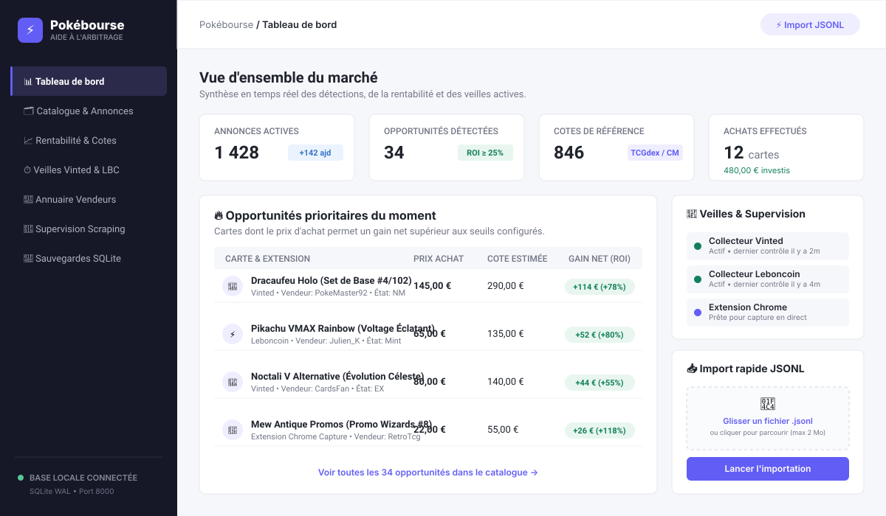
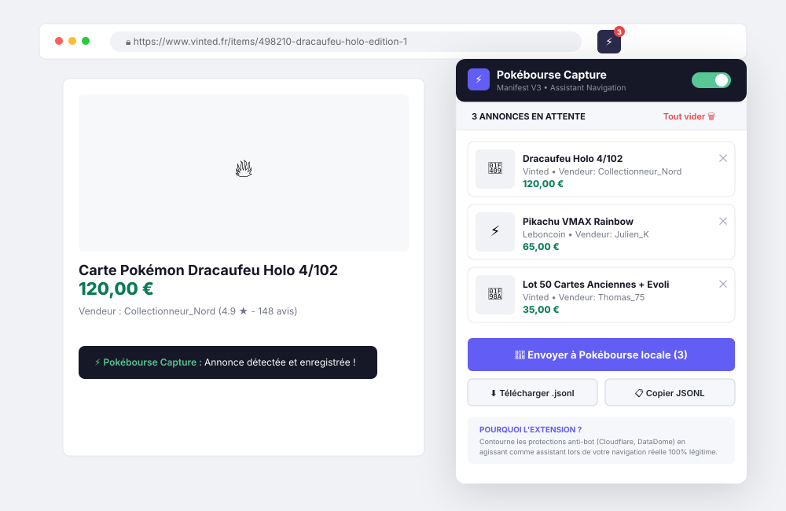
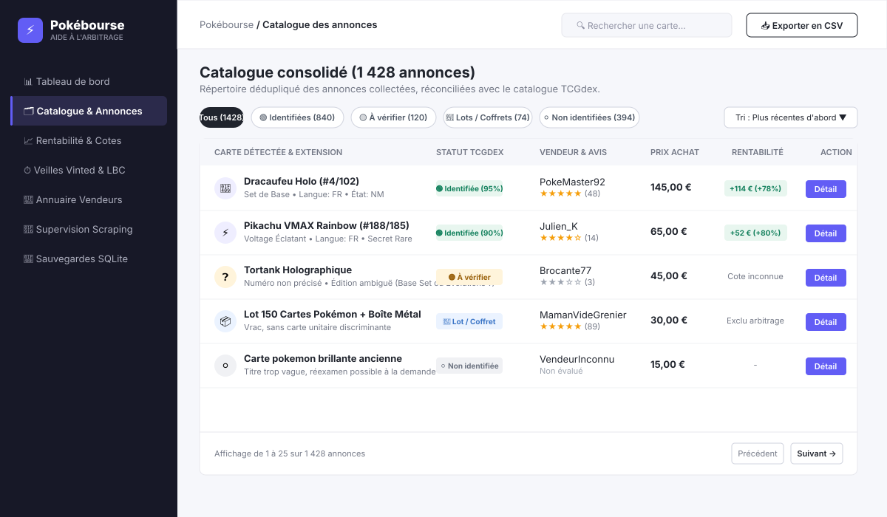
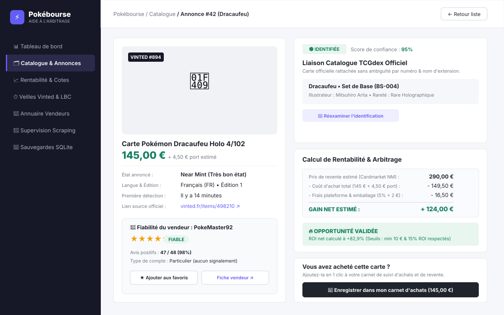
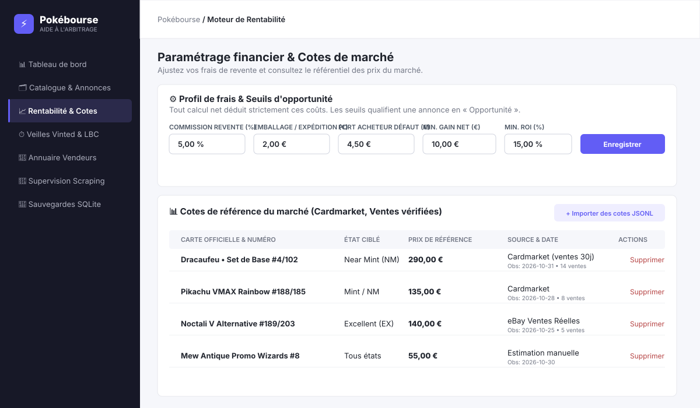
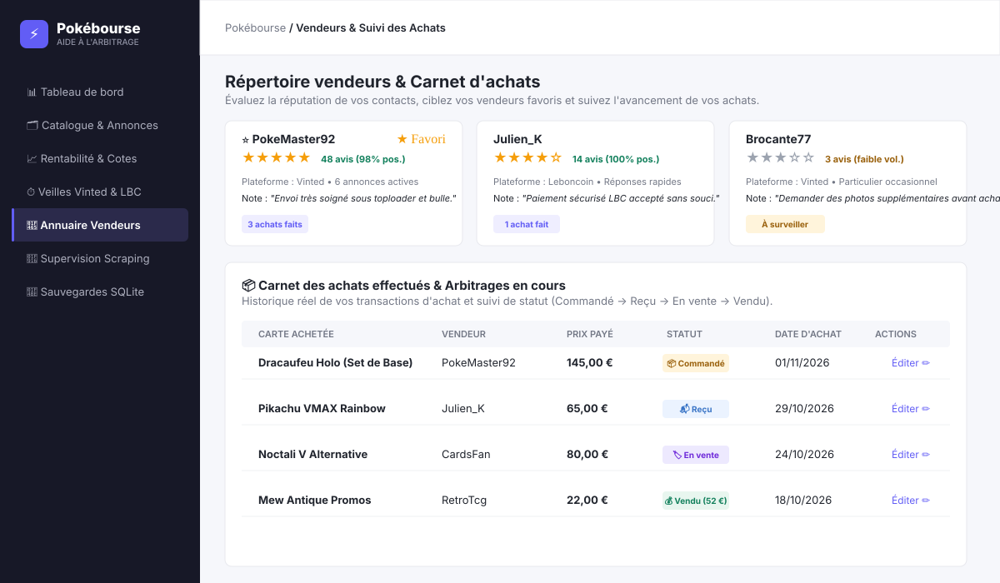
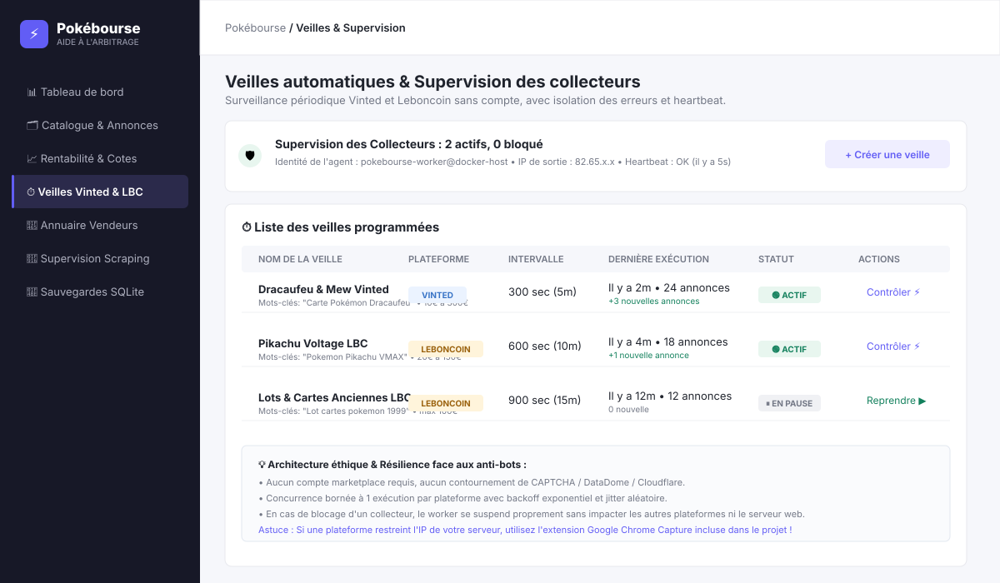

# ⚡ Pokébourse

[](https://www.python.org/)
[](https://fastapi.tiangolo.com/)
[](https://www.sqlite.org/)
[](https://docs.docker.com/compose/)
[](extension/README.md)
[](#)

> **Plateforme locale d’aide à la décision pour la détection d'opportunités, l’identification et l’arbitrage d’achat-revente de cartes Pokémon.**

Pokébourse analyse le marché d'occasion (Vinted, Leboncoin, eBay, Wallapop, imports manuels, extension de navigation), identifie formellement les cartes grâce au catalogue officiel **TCGdex**, et calcule la rentabilité nette exacte de chaque annonce en tenant compte de tous les frais réels (commissions, frais de port, emballage, cotes de marché).

---

## 🎯 Pourquoi Pokébourse ?

Le marché d'occasion des cartes Pokémon présente plusieurs défis majeurs :
1. **Les fausses opportunités** : Une carte achetée 15 € et cotée 20 € génère souvent une perte une fois déduits le port aller, la commission de la plateforme, l'enveloppe bulle et le toploader.
2. **Le piège des lots et des descriptions floues** : De nombreux outils automatisés associent aveuglément un lot de 50 cartes à la carte la plus chère du lot, créant des alertes erronées.
3. **Les protections anti-bot strictes** : Les plateformes grand public (Vinted, Leboncoin) bloquent l'aspiration automatisée par script headless.
4. **Le manque de suivi d'investissement** : Impossible d'évaluer ses gains réels sans un carnet d'achats et de reventes rigoureux.

**Pokébourse résout ces problèmes en local, de façon 100 % privée et transparente, sans dépendance cloud payante ni compte marketplace requis.**

---

## ⚡ Démarrage Rapide en 60 secondes

### Prérequis
- [Docker](https://docs.docker.com/get-docker/) avec le plugin **Docker Compose**.
- Aucun environnement Python n'est nécessaire sur votre machine hôte : tout s'exécute dans les conteneurs isolés.

### Lancer Pokébourse

```bash
# 1. Cloner le dépôt et entrer dans le dossier
git clone <url-du-depot> pokebourse
cd pokebourse

# 2. Démarrer l'application web et le worker de surveillance
docker compose up --build -d
```

### Accès aux services
- **Interface Web principale** : [http://localhost:8000](http://localhost:8000)
- **Contrôle de santé API** : [http://localhost:8000/health](http://localhost:8000/health)
- **Logs du worker de veille** : `docker compose logs -f worker`

Pour arrêter l'application tout en conservant l'intégralité de vos données :
```bash
docker compose down
```
> [!IMPORTANT]
> Ne lancez jamais `docker compose down -v` ou `down --volumes` : vos annonces, cotes et historiques sont conservés dans le volume Docker persistant `pokemon-data`.

---

## 🧭 Visite Guidée & Fonctionnement

---

### 0. La navigation cible : capturer → décider → acheter

L'interface est organisée autour d'un parcours quotidien en six entrées directes, plus un hub d'administration avancée :

| Entrée | Contenu | Route |
|---|---|---|
| **Accueil** | Opportunités prioritaires, éléments à vérifier, achats en cours, activité récente | `/` |
| **Opportunités** | Catalogue et analyse de rentabilité unifiés (verdicts, tris gain/ROI, export CSV) | `/catalog` |
| **Recherche** | Moteur unifié cartes officielles, annonces locales et recherche externe contrôlée | `/search` |
| **Tendances** | Variations de prix Cardmarket (7j/30j), activité des annonces et meilleures affaires | `/trends` |
| **Mes achats** | Suivi du portefeuille, cycle de vie, prix de vente réel facultatif et coûts par devise | `/achats` |
| **Réglages** | Frais, seuils, cotes de marché manuelles, synchronisations Cardmarket et configuration | `/reglages` |
| **Gestion avancée** | Vendeurs, veilles, imports, TCGdex, annotations ML, agents, sauvegardes | `/gestion` et pages spécialisées |

Le bouton global **« Ajouter des annonces »** propose :
1. **Saisie assistée par URL** (`/ajouter-annonce`) : reconnaissance syntaxique locale de la plateforme et de l'identifiant pour eBay, Vinted, Leboncoin et Wallapop, sans téléchargement intrusif de la page distante. Pré-analyse indicative en lecture seule avant enregistrement.
2. **Capture via l'extension Chrome** : prévisualisation unitaire d'une annonce dans Pokébourse avec vérification et correction des champs (`POST /previsualiser-capture`), ou envoi direct par lot vers `/imports`.
3. **Importation d'un fichier JSONL** : téléversement direct de fichiers volumineux d'annonces ou de cotes.
4. **Création d'une veille automatique** : programmation d'une surveillance continue sur vos critères de prix et de mots-clés.

> [!NOTE]
> Les fonctions avancées ont été **regroupées, jamais supprimées** : toutes les routes, formulaires, exports et téléchargements existants restent disponibles (les anciennes URL `/profitability` redirigent de manière transparente vers `/catalog` ou `/reglages` selon leurs paramètres et ancres).

Le parcours recommandé : **capturer** une annonce (extension Chrome, saisie d'URL ou import) → **décider** depuis la fiche annonce (verdict, gain net, ROI, comparables, cote Cardmarket et OCR) → **suivre l'achat** dans « Mes achats ».

---

### 1. Le Tableau de Bord (Dashboard)

Le tableau de bord centralise en un coup d'œil la météo du marché et la santé de votre système local :
- **Indicateurs clés (KPIs)** : volume d'annonces surveillées, nombre d'opportunités rentables détectées, cotes de référence chargées et montant total investi.
- **Opportunités prioritaires** : cartes immédiatement actionnables classées par gain net et retour sur investissement (ROI).
- **Importation rapide JSONL** : glisser-déposer un fichier d'annonces pour analyse instantanée.
- **Journal des imports & Échecs récents** : transparence totale sur les fichiers importés et rapport téléchargeable des erreurs.



---

### 2. L'Extension Chrome — Pokébourse Capture

Pour surmonter les protections anti-bot (Cloudflare, DataDome) sans risque de bannissement, Pokébourse inclut une extension Chrome officielle (**Manifest V3**) dans le dossier [`extension/`](extension/README.md) :

- **Capture automatique pendant votre navigation réelle** : dès que vous visitez une annonce Pokémon sur Vinted, Leboncoin ou une boutique TCG, l'extension extrait proprement les données (titre, prix, vendeur, image, état).
- **Notification Toast discrète** : confirmation visuelle en haut à droite sans perturber votre consultation.
- **Prévisualisation avant enregistrement (recommandé)** : sélectionnez **exactement une** annonce et cliquez sur **« 🔍 Prévisualiser »**. Pokébourse s'ouvre dans un nouvel onglet et présente, sans rien écrire : l'extrait de l'annonce avec la provenance de chaque champ (extrait de la page, saisi ou corrigé par vous, manquant), une identification proposée (statut, candidats, score — jamais une confirmation humaine), et une rentabilité indicative fondée sur les seules références locales (cotes enregistrées, médiane des comparables, Cardmarket relié de façon fiable). Après vérification et correction éventuelle, **« Confirmer et ajouter l'annonce »** enregistre via le flux transactionnel existant (déduplication, `first_seen_at` préservé). Si plusieurs annonces sont cochées, le popup l'indique explicitement : une prévisualisation à la fois, jamais de lot validé silencieusement. Si Pokébourse est indisponible, les captures restent dans l'extension.
- **Envoi direct en 1 clic** : transmettez votre panier de cartes directement à Pokébourse locale (`POST http://localhost:8000/imports`) avec estimation financière immédiate.
- **Export & Sauvegarde** : exportez également vos captures en fichier standard `.jsonl` horodaté ou dans le presse-papier.

**Limites réelles du parcours de prévisualisation** : l'extension ne transmet que ce qu'elle a lu sur la page ouverte — une information absente est présentée comme manquante, jamais inventée ; la langue n'est jamais déduite et doit être choisie avant confirmation ; l'image principale est affichée depuis son URL d'origine (le serveur local ne télécharge aucune image) et n'est pas conservée par le flux d'import ; les numéros/extensions extraits par l'extension sont des indices heuristiques, pas des preuves. L'estimation Cardmarket n'est ni un prix temps réel garanti, ni une vente conclue, ni une preuve d'état ou d'authenticité.

**Provenance et confirmation de l’identité (T03)** : « Indices et provenance »
distingue les textes, les champs extraits/saisis et les suggestions préremplies
ou issues de l’OCR. Ces suggestions restent à vérifier après réanalyse et ajout
de l’annonce. Un désaccord significatif bloque la nouvelle acceptation automatique ;
les références contradictoires apparaissent séparément dans le diagnostic.
La confirmation d’identité utilise l’action dédiée de la fiche, distincte de
l’enregistrement. Le [contrat de preuves et la politique de réexamen](docs/identification/T03_EVIDENCE.md)
documentent la compatibilité JSONL, les versions et la migration additive `0022`.



> [!TIP]
> **Installation de l'extension en 3 clics** :
> 1. Ouvrez `chrome://extensions/` dans Google Chrome et cochez le **Mode développeur**.
> 2. Cliquez sur **Charger l'extension non empaquetée**.
> 3. Sélectionnez le sous-dossier `extension/` du projet. C'est tout !

---

### 3. L'Ajout d'Annonces : Saisie Assistée par URL (`/ajouter-annonce`) & Imports JSONL

Le bouton global **« Ajouter des annonces »** de la barre supérieure centralise l'entrée des données :

- **Ajout par URL d'annonce (`/ajouter-annonce`)** :
  - Collez l'URL d'une annonce provenant d'**eBay**, **Vinted**, **Leboncoin** ou **Wallapop**.
  - **Analyse syntaxique 100 % locale** : Pokébourse identifie la plateforme et extrait l'identifiant externe sans rien présupposer. Les liens raccourcis ne sont pas acceptés.
  - **Préremplissage borné, uniquement sur autorisation explicite** : si le domaine de l'annonce figure dans l'allowlist locale (`POKEMON_PAGE_FETCH_ALLOWED_HOSTS` ; avec Compose, `vinted.fr,vinted.net` sont configurés pour ce parcours), le serveur télécharge la page de façon strictement bornée (HTTPS seul, anti-SSRF avec vérification des adresses IP publiques à chaque redirection, 3 redirections maximum, 10 s de timeout, HTML limité à 2 Mo) puis tente une extraction JSON-LD → OpenGraph → balises HTML. Sinon, un message propose la capture par extension ou la saisie manuelle. Chaque champ prérempli est présenté avec son statut (trouvé / proposé / manquant) et sa provenance (extraite, saisie, corrigée) ; aucune valeur n'est inventée.
  - **OCR local indicatif** : l'image principale extraite (≤ 8 Mo, HTTPS publique) est lue par Tesseract 100 % localement et en mémoire ; les indices reconnus (noms, numéros) alimentent l'analyse sans jamais bloquer l'enregistrement.
  - **Détection des doublons** : vérifie immédiatement si l'annonce existe déjà dans votre catalogue (`(source, external_id)`).
  - **Saisie et vérification humaine** : complétez le titre, le prix, l'état, la langue, les frais de port et le vendeur. Un champ laissé vide reste inconnu (aucune valeur favorable n'est supposée).
  - **Pré-analyse indicative en lecture seule** : le bouton **« Analyser les informations saisies »** lance une détection des preuves, propose une identification TCGdex et calcule la rentabilité indicative sans modifier la base de données.
  - **Enregistrement transactionnel** : le bouton **« Enregistrer l'annonce »** injecte la fiche via le pipeline sécurisé `app.catalog.import_jsonl` avec déduplication et préservation stricte de la date de première observation (`first_seen_at`).
- **Importation en masse JSONL** : déposez un fichier `.jsonl` depuis le tableau de bord pour alimenter votre catalogue en masse.
- **Gestion des erreurs d'import** : journal détaillé des lots rejetés ou corrompus avec rapport CSV téléchargeable (`/imports/failures/report`).

**Limites réelles du parcours par URL** : la récupération serveur n'a lieu que pour un domaine explicitement autorisé (allowlist vide par défaut : aucune plateforme marketplace n'y figure, conformément aux CGU recensées dans `SOURCES.md`) ; l'extraction est limitée aux métadonnées déclaratives (JSON-LD, OpenGraph, balises HTML) — aucun JavaScript n'est exécuté, une page rendue uniquement côté client fournira donc peu ou pas de données ; l'OCR est indicatif (qualité variable selon la photo) et ne confirme jamais une identité ; la devise n'est jamais supposée et doit être choisie explicitement avant l'enregistrement ; l'enregistrement final passe toujours par le flux transactionnel `app.catalog.import_jsonl` avec déduplication et préservation de `first_seen_at`.

---

### 4. Le Catalogue & L'Identification TCGdex (`/catalog`)

Toutes les annonces (veilles, imports JSONL, saisie par URL ou extension Chrome) convergent dans le catalogue unifié (`/catalog`) :
- **Recherche plein texte** : par nom de carte, numéro ou mot-clé dans le titre original.
- **Filtres de décision & Rentabilité** : filtrage par verdict d'arbitrage (*Opportunité*, *À surveiller*, *Non rentable*, *Sans cote*), par statut d'identification, par extension officielle et par plateforme source.
- **Tris multi-critères** : gain net estimé, ROI en points de base, prix d'achat, date de découverte ou fiabilité vendeur.
- **Pagination et Export CSV** : 25 annonces par page avec export CSV compatible Excel (encodage UTF-8 avec BOM, séparateur point-virgule et protection anti-injection).



#### Les 4 Statuts d'Identification TCGdex :
Le moteur d'identification (`app/identification/`) compare chaque annonce au référentiel officiel Pokémon :
1. 🟢 **Identifiée (`identified`)** : Le nom et le numéro concordent avec une carte officielle TCGdex (ex: *Dracaufeu #4/102*). Les métadonnées sont normalisées et le moteur de rentabilité s'active immédiatement.
2. 🟡 **À vérifier (`ambiguous`)** : Plusieurs cartes concordent sans critère discriminant fort (ex: réédition sans précision du numéro de série, ou numéro isolé sans dénominateur). Le système s'abstient pour éviter toute fausse conclusion.
3. 🔵 **Lot / Coffret (`lot`)** : Détection explicite de termes de vrac, boosters scellés, coffrets ou displays. **Règle absolue : aucun lot n'est jamais rattaché arbitrairement à une seule carte**.
4. ⚪ **Non identifiée (`unidentified`)** : Annonce au libellé trop vague. Elle reste consultable et réexaminable à la demande via le bouton **Réexaminer l’identification**.

> **Mise à jour du référentiel** : le bouton **« Réexaminer l’identification »** de la page Catalogue relance le moteur sur toutes les annonces non identifiées avec le référentiel courant — à utiliser après une synchronisation du catalogue TCGdex pour rattacher les annonces importées alors que le référentiel était encore incomplet. Les confirmations humaines restent prioritaires.

#### Recherche approfondie et confirmation humaine :
La fiche annonce permet de rechercher dans le cache local, de mettre en file une recherche TCGdex ciblée, de comparer les candidats, puis de confirmer ou retirer une carte. Les preuves, décisions et recherches sont persistées dans SQLite et incluses dans les sauvegardes. Une modification de prix ne retire pas une confirmation ; une modification des preuves d’identité la signale « à revoir ». Un faux classement en lot doit être corrigé avec un motif avant toute confirmation unitaire.

L’enrichissement automatique des annonces non résolues est **désactivé par défaut**. Pour l’activer, définir `TCGDEX_AUTO_ENRICH=true` sur les services `app` et `worker`. La recherche manuelle reste disponible sans ce réglage. `TCGDEX_SEARCHES_PER_TICK` borne le nombre de recherches par passage du worker (1 par défaut, maximum 10). Sans worker, une demande reste « En attente du worker ».

Seuls le nom, le numéro, l’extension ou l’identifiant de carte sont envoyés à TCGdex, jamais le titre brut, la description ou le vendeur. Le catalogue fourni est français : une langue étrangère explicite n’est pas remplacée silencieusement par une référence française. Une référence trouvée ne fournit pas de cote de revente.

---

### 5. La Recherche Avancée Multi-Critères & Externe (`/search`)

Un espace unifié de recherche locale sans appel réseau :
- **Recherche plein texte & indexée** : nom de carte, numéro local, identifiant TCGdex (ex. `base1-58`) ou titre d'annonce, optimisée par les index SQLite dédiés (`0020_search_indexes.sql`).
- **Portée ajustable** : Tout (cartes du référentiel et annonces), Cartes officielles uniquement ou Annonces observées uniquement.
- **Filtres officiels (référentiel)** : extension, rareté officielle (`pokemon_reference_cards.rarity`), année ou intervalle d’années de sortie (`pokemon_reference_sets.release_date`).
- **Filtres de marché (annonces)** : prix minimum et maximum en euros, état, langue, variante, édition, société de gradation (PSA, PCA, BGS, CGC, CollectAura) et note, source (Vinted, Leboncoin, eBay, Wallapop, manuel), statut d'identification et inclusion/exclusion des lots.
- **Règles d'intégrité strictes** : les filtres de rareté et d'année passent impérativement par `reference_card_id` (une annonce non identifiée n'est jamais polluée par une rareté supposée ; aucun lot n'est jamais rattaché à une carte unitaire).
- **Distinction exacte vs suggestions approchées** : lorsqu'aucun résultat exact n'est trouvé, des suggestions orthographiques issues du lexique officiel sont clairement identifiées.
- **Export CSV cohérent** (`/search/export.csv`) : télécharge l'intégralité des annonces correspondant aux critères (avec attributs d'identification et respect strict du RGPD vendeur).

#### Recherche externe contrôlée :
Accessible via le bouton explicite **« Rechercher aussi à l'extérieur »** (`/search?q=...&external=1`), cette passerelle permet d'élargir la recherche sans compromettre la résilience locale :
- **Déclenchement uniquement explicite** : aucun appel réseau lors d'une recherche ordinaire.
- **Résilience absolue** : si toutes les sources distantes sont hors service, les résultats locaux restent immédiatement affichés et utilisables.
- **Sources autorisées** :
  - **TCGdex (référentiel officiel)** : les demandes de complétion sont enfilées dans la table persistante `identification_searches` avec déduplication stricte des critères. Seuls les champs utiles (nom, numéro, extension) sont transmis — aucun titre brut, description ou donnée vendeur. Le worker d'arrière-plan résout la file et enrichit le cache SQLite local.
  - **eBay** : interrogation bornée avec connecteur officiel, backoff exponentiel et gestion de quotas.
- **Sources indisponibles documentées** : Vinted et Leboncoin sont signalées avec statut explicite « Non disponible » et motif (respect des CGU et protections anti-bot documentées dans `SOURCES.md`), avec invitation à utiliser l'extension Chrome ou l'import JSONL.
- **Import contrôlé en un clic** (`POST /search/external/import`) : déduplication stricte sur `(source_id, external_id)`, préservation inviolable de `first_seen_at` lors des ré-ingestions, mise à jour de `last_seen_at` et du prix, historique conservé dans `listing_observations`, respect strict de la liste blanche RGPD pour les profils vendeurs.

---

### 6. Les Tendances de Marché & Opportunités d'Arbitrage (`/trends`)

L'espace **Tendances** (`/trends`) permet d'observer la dynamique des prix et le niveau d'activité sur le marché :

- **Variations de prix Cardmarket officielles** :
  - Évolution des moyennes de vente : comparaison `avg7` vs `avg30` (dynamique moyen terme) et `avg1` vs `avg7` (dynamique court terme).
  - Variations chiffrées en centimes d'euros et en points de base (`bps`), calculées avec précision monétaire stricte (arrondi demi-supérieur `ROUND_HALF_UP`).
  - Produits sans prix ou sans antériorité suffisante exclus pour éviter les pourcentages aberrants.
- **Activité des annonces récentes** :
  - Nombre d'annonces observées par carte dans le catalogue local sur une fenêtre glissante de 7 ou 30 jours.
  - **Honnêteté des données** : cet indicateur reflète fidèlement la présence de la carte dans les offres collectées, sans jamais prétendre faussement être un volume de ventes conclues.
- **Radar des meilleures opportunités** :
  - Sélection des annonces générant le meilleur gain net estimé et le retour sur investissement le plus élevé.
  - Vérification de la fraîcheur des données et affichage clair de la source de cotation.
- **Filtres de marché** : sélection de la période (7 jours ou 30 jours), de l'extension officielle, de la rareté et d'un seuil minimum d'observations.

---

### 7. L'Assistance Visuelle & OCR Local (`/ocr/suggestions`)

Le [tasking d'identification fiable de bout en bout](TASKING_IDENTIFICATION_FIABLE.md) décrit les travaux à réaliser et leurs critères de validation : détection des lots, preuves, couverture du référentiel, OCR, vérification humaine et évaluation. Il distingue le fonctionnement actuel des améliorations planifiées.

Pokébourse intègre un moteur de reconnaissance optique de caractères (OCR) **100 % local et conteneurisé** pour faciliter l'identification d'une carte à partir d'une photo :

- **Accessibilité immédiate** : disponible directement sur la fiche détaillée (`/catalog/{id}`) et dans les formulaires de réconciliation d'annonces.
- **Formats supportés** : téléversement de fichiers JPEG, PNG et WebP jusqu'à 8 Mo et 12 millions de pixels.
- **Moteur Tesseract embarqué** : reconnaissance exécutée en local (`tesseract stdin stdout -l fra+eng --psm 11`) sans aucun abonnement payant ni dépendance cloud.
- **Extraction des preuves clés** : analyse du texte pour repérer le nom de la carte Pokémon, le numéro imprimé (`X/Y` ou numéro isolé), l'extension et les points de vie (PV).
- **Suggestions en 1 clic** : mise en correspondance instantanée des indices relevés avec le référentiel TCGdex local. L'utilisateur peut préremplir la recherche ou valider le candidat en un clic.
- **Respect absolu de la vie privée & Zéro persistance** :
  - L'image est décodée en mémoire vive via Pillow, nettoyée de ses métadonnées EXIF, et détruite après analyse.
  - Aucun fichier photo n'est enregistré sur le disque de l'application ni stocké en base de données.
  - Aucun appel réseau distant : vos photos restent confinées à votre machine locale.
  - *Exception explicite et opt-in* : un bloc dédié de la fiche annonce permet de **conserver volontairement** une photo comme preuve durable (benchmark, annotation ou confirmation). Ces preuves sont dédupliquées, dépourvues d'EXIF, stockées dans l'espace contrôlé `evidence/` (quotas, purges et statuts d'intégrité) et sauvegardées/restaurées avec la base. Sans cette action explicite, rien n'est conservé.

---

### 8. La Fiche Détaillée, Preuves de Prix & Comparables (`/catalog/{id}`)

En cliquant sur une carte du catalogue (`/catalog/{id}`), vous accédez à l'analyse décisionnelle complète :



- **Liaison Catalogue TCGdex** : carte officielle rattachée, visuel haute définition, illustrateur, rareté, points de vie et score de confiance.
- **Décomposition financière transparente** :
  $$\text{Gain Net} = \text{Prix de revente estimé} - \text{Commission plateforme} - \text{Frais fixes} - \text{Port/Emballage} - (\text{Prix d'achat} + \text{Port aller})$$
  $$\text{ROI} = \frac{\text{Gain Net}}{\text{Prix d'achat} + \text{Port aller}}$$
- **Valeur de marché Cardmarket (fichiers officiels)** : tendance et moyennes de vente 1/7/30 jours d'un produit lié explicitement et sans ambiguïté à la carte identifiée. Un simple nom commun à plusieurs cartes ne suffit pas à établir une cote : elle reste inconnue tant que le produit exact n'est pas lié. Le prix est agrégé et ne garantit ni état ni langue. Le worker synchronise quotidiennement le guide ; un bouton manuel est disponible dans Réglages.
- **Preuves de prix & cartes comparables** : La section *Preuves de prix · Annonces & ventes réelles* regroupe les éléments tangibles étayant l'estimation de revente :
  1. *Ventes conclues & cotes enregistrées* : issues de `market_references` (ex: ventes eBay réussies, Cardmarket) avec lien direct vers la source et date d'observation.
  2. *En vente actuellement* : annonces similaires actives dans le catalogue local.
  3. *Déjà revendus par vos soins* : achats passés de votre portefeuille passés au statut `vendu`.
  Chaque ligne indique l'écart de prix net en centimes et euros ($\pm X,XX\text{ €}$ vs estimation) pour valider immédiatement la crédibilité du prix retenu.
- **Assistance OCR intégrée** : bouton pour analyser une photo de la carte et suggérer les candidats du référentiel.
- **Preuves visuelles conservées (opt-in)** : un bloc dédié permet de conserver explicitement une photo comme preuve durable (benchmark, annotation ou confirmation d'une décision fondée image). Chaque preuve est dédupliquée, dépourvue d'EXIF, rattachée à ses lectures (champ, région, version des transformations) et suivie par un statut d'intégrité (présent/manquant/corrompu/supprimé). L'analyse OCR simple, elle, ne conserve rien.
- **Bouton d'enregistrement d'achat** : un clic convertit l'annonce observée en achat officiel dans votre carnet de suivi.

---

### 9. Le Moteur de Rentabilité & Réglages Financiers (`/reglages`)

Accessible via la page **Réglages** (`/reglages`, avec redirection automatique des anciennes URL `/profitability`), le moteur permet de piloter précisément vos hypothèses d'investissement :



1. **Modèle de prix hybride à 3 niveaux** :
   - **Niveau 1 — Cote de marché dédiée prioritaire** : issue de `market_references` (ventes conclues Cardmarket, eBay réelles ou estimations manuelles avec source et date d'observation).
   - **Niveau 2 — Repli sur la médiane du catalogue** : calculée sur les autres annonces identiques (même nom, numéro, langue, état, variante et devise).
   - **Niveau 3 — Dernier repli : prix tendance Cardmarket** : si aucune référence ni médiane n'existe, seul un produit Cardmarket relié explicitement et de façon unique à la carte TCGdex identifiée, avec un prix positif, peut fournir une estimation en EUR. Une correspondance par nom seule ne suffit pas.
2. **Profil de frais personnalisable** :
   - Commission de revente en points de base (ex: 500 bps = 5,00 %).
   - Frais fixes vendeur (€) et coût d'emballage/expédition (€).
   - Frais de port acheteur par défaut.
   - Seuils de qualification : gain net minimum (ex: 10,00 €) et ROI minimum (ex: 15,00 %).
3. **Synchronisation Cardmarket quotidienne** : Price guide public (~80 000 cartes en EUR, gratuit, sans compte) synchronisé automatiquement chaque nuit par le worker vers 03:20 (heure de Paris), plus bouton **« Tout synchroniser maintenant »** pour un rafraîchissement immédiat.
4. **Zéro approximation financière** : Tous les montants sont calculés en centimes entiers et les pourcentages en points de base (`bps`), éliminant les erreurs d'arrondis des nombres à virgule flottante.

---

### 10. Mes Achats & Suivi du Portefeuille (`/achats`)

La page **Mes achats** (`/achats`) centralise le pilotage de vos investissements :

- **Cycle de vie complet** :
  - `📦 Commandé` : annonce achetée sur la marketplace, en attente d'expédition.
  - `📬 Reçu` : carte livrée et inspectée.
  - `🏷️ En vente` : carte remise en vente sur votre propre canal.
  - `💰 Vendu` : transaction finale conclue.
- **Prix de vente réel facultatif (`sale_price_cents`)** :
  - Ajouté par la migration SQLite `0021_purchase_sale_price.sql`.
  - Permet d'enregistrer le montant réel perçu lors de la revente finale.
  - **Rigueur financière** : les frais de revente réels n'étant pas collectés sur chaque plateforme de sortie, aucune rentabilité réalisée théorique n'est inventée sans données complètes.
- **Synthèse des investissements par devise** : totaux d'achats distincts en EUR, USD et GBP sans conversion arbitraire.
- **Accès direct aux annonces et aux profils vendeurs** : lien vers l'annonce d'origine et la fiche du vendeur partenaire.

---

### 11. Annuaire des Vendeurs, Pépites & CRM (`/sellers`)

Pokébourse enrichit les annonces avec les profils publics des vendeurs (`/sellers`) et gère vos relations commerciales :



- **Indicateur de Fiabilité (★ à ★★★★★)** :
  - Calculé sur les avis réels de la plateforme (Vinted / Leboncoin).
  - Plafonné à 3 étoiles si le vendeur compte moins de 5 avis.
  - Plafonné à 2 étoiles si le taux d'avis négatifs dépasse 10 %.
  - 0 étoile pour un compte banni.
- **Classement Multi-axes** :
  - ⭐ **Les plus fiables** : vendeurs les mieux notés avec historique d'avis vérifié.
  - 🏆 **Meilleures pépites** : vendeurs mettant en ligne le plus de cartes sous-évaluées détectées comme *Opportunité*.
  - 💳 **Fournisseurs clés** : partenaires chez qui vous avez le plus acheté.
  - ❤️ **Favoris & Notes privées** : marquez vos vendeurs de confiance et enregistrez des notes sur leurs habitudes de négociation.
- **Fiche Vendeur Détaillée (`/sellers/{id}`)** : inventaire en direct des cartes en vente du vendeur et historique complet des achats passés.
- **Protection stricte de la vie privée (RGPD)** : les informations personnelles sensibles (emails, téléphones, coordonnées postales) sont filtrées par liste blanche stricte et jamais stockées.

---

### 12. Validation Humaine & Pilote d'Annotation ML Phase 0 (`/annotations`, `/identification/diagnostics`)

Pour préparer les futurs modèles de Machine Learning sans biaiser l'apprentissage, Pokébourse intègre un banc de validation humaine rigoureux :

- **Diagnostic lexical (`/identification/diagnostics`)** : examen des annonces non identifiées ou ambiguës, détection des fautes d'orthographe probables via index trigrammes et distance de Levenshtein (ex: « dracofeu 4/102 » suggérant Dracaufeu). Également disponible en ligne de commande :
  ```bash
  docker compose run --rm app pokemon-arbitrage diagnose-identification --status all --limit 100 --json
  ```
  Voir [le diagnostic lexical et ses règles](docs/IDENTIFICATION_LEXICALE.md).
- **Pilote d'annotation Phase 0 (`/annotations`)** :
  - Constitution d'une file stratifiée de 300 annonces avec 60 doubles lectures aveugles.
  - Isolation stricte des annotateurs garantie par la variable `POKEMON_REVIEW_OPERATOR`.
  - Parcours de double lecture aveugle masquant suggestions et historiques.
  - Écran d'attente opérateur (`annotation_blocked.html`) si une seconde lecture requiert un autre annotateur.
  - Arbitrage des divergences et export reproductible du dataset de référence :
  ```bash
  docker compose run --rm app pokemon-arbitrage export-labels --output /data/labels-pilote.jsonl
  ```
- **Validation manuelle sur fiche annonce (`/catalog/{id}/review`)** : formulaire de confirmation ou de correction manuelle, avec motifs explicites (carte confirmée, lot, hors périmètre, carte absente, preuves insuffisantes).

---

### 13. Veilles Automatiques & Supervision des Collecteurs (`/watches`, `/agents`)

Le worker d'arrière-plan (`python -m app.worker`) exécute les veilles périodiques programmées (`/watches`) :



- **Surveillance ciblée** : paramètres de recherche personnalisés (mots-clés, prix min/max, intervalle en secondes).
- **Contrôle manuel à la demande** : bouton **Contrôler ⚡** pour déclencher une vérification immédiate.
- **Supervision en direct (`/agents`)** :
  - Suivi des états : *Opérationnel*, *Dégradé*, *Bloqué*, *Hors-ligne*, *Arrêté*.
  - IP publique de sortie détectée via `https://api.ipify.org` à chaque démarrage du worker, enregistrée pour l’agent et ses collecteurs, puis affichée sur `/agents`. En cas d’échec de la sonde, l’interface affiche « IP inconnue » sans interrompre le worker. L’URL est personnalisable avec `POKEMON_SUPERVISION_IP_PROBE_URL`.
  - **Résilience anti-bot** : en cas d'erreur 403 / 429 ou CAPTCHA, le collecteur concerné se suspend temporairement sans jamais bloquer les autres plateformes ni le serveur web.

---

### 14. Sauvegardes & Restauration SQLite (`/backups`)

La sécurité de vos données est assurée sur la page **Sauvegardes** (`/backups`) :
- **Copies à chaud non bloquantes** : utilisation de l'API de sauvegarde en ligne de SQLite (`sqlite3_backup`), garantissant une copie cohérente même en pleine écriture.
- **Contrôle d'intégrité strict** : chaque fichier créé ou restauré fait l'objet d'un `PRAGMA integrity_check`.
- **Restauration sécurisée** : création automatique d'un snapshot de sécurité de la base actuelle avant toute restauration, suivie de l'application automatique des éventuelles migrations manquantes.

---

### 15. Hub de Gestion Avancée (`/gestion`)

Pour conserver une interface claire et épurée au quotidien, la vue **Gestion avancée** (`/gestion`) réunit l'ensemble des modules d'administration :
- **Indicateurs réels d'état du système** : nombre de vendeurs suivis, veilles actives, état du référentiel TCGdex, avancement du pilote d'annotation ML, état de santé des agents de supervision et volume des sauvegardes disponibles.
- **Navigation directe et raccourcis** : accès en un clic vers chaque espace spécialisé (Vendeurs, Veilles, Imports, Référentiel TCGdex, Annotations ML, Diagnostic lexical, Agents et Sauvegardes).
- **Zéro donnée fictive** : chaque indicateur reflète exactement l'état de la base SQLite locale.

---

## 📥 Format d'Import de Fichiers JSONL

Vous pouvez importer des annonces ou des cotes en masse via l'interface web ou la ligne de commande.

### Format d'annonces (`annonces.jsonl`)

Un objet JSON par ligne, encodé en UTF-8 (taille max : 2 Mo) :

```jsonl
{"external_id":"vinted-89102","name":"Dracaufeu","set_name":"Set de Base","card_number":"4/102","language":"fr","condition":"NM","price_cents":14500,"currency":"EUR","seller":"PokeMaster92","url":"https://www.vinted.fr/items/89102"}
{"external_id":"lbc-77123","name":"Pikachu VMAX","set_name":"Voltage Éclatant","card_number":"188/185","price_cents":6500,"currency":"EUR","seller":"Julien_K","url":"https://www.leboncoin.fr/collection/77123"}
```

| Champ | Requis | Description |
|---|---|---|
| `external_id` | **Oui** | Identifiant unique de l'annonce pour la plateforme source |
| `name` | **Oui** | Nom de la carte Pokémon |
| `set_name` | **Oui** | Nom de la série / extension officielle |
| `price_cents` | **Oui** | Prix demandé en centimes d'euros (`14500` = `145,00 €`) |
| `card_number` | Non | Numéro de la carte dans l'extension (ex: `4/102`, `188/185`) |
| `language` | Non | Code langue (`fr`, `en`, `ja`), `fr` par défaut |
| `condition` | Non | État de la carte (`NM`, `EX`, `Good`, `Played`) |
| `variant` | Non | Variante (*Holo*, *Reverse*, *Secret Rare*...) |
| `grading_company` | Non | Organisme de certification (*PSA*, *PCA*, *BGS*, *CGC*) |
| `grade` | Non | Note attribuée (ex: `9`, `10`) |
| `seller` | Non | Pseudonyme public du vendeur |
| `url` | Non | Lien web vers l'annonce d'origine |

### Format des cotes de référence (`cotes.jsonl`)

```jsonl
{"name":"Dracaufeu","set_name":"Set de Base","card_number":"4/102","condition":"NM","reference_price_cents":29000,"currency":"EUR","source_name":"Cardmarket","reference_kind":"ventes_conclues","observed_at":"2026-10-31","sample_size":14}
```

---

## 🛠️ Utilisation en Ligne de Commande (CLI)

Le menu **Référentiel TCGdex** (`/tcgdex`) permet de sélectionner les extensions à enrichir, suivre les identités et fiches détaillées chargées, puis mettre en pause ou reprendre leur traitement par le worker. Les confirmations humaines sont conservées. Voir le [guide de synchronisation](docs/TCGDEX_SYNC.md) pour le cache de 24 heures, la cadence et les limites de couverture.

Toutes les opérations d'administration peuvent être pilotées depuis le conteneur `app` via la commande `pokemon-arbitrage` :

```bash
# Vérifier l'état et l'intégrité de la base de données
docker compose run --rm app pokemon-arbitrage check

# Appliquer manuellement les migrations SQLite
docker compose run --rm app pokemon-arbitrage migrate

# Mettre en file l’enrichissement d’une extension et consulter sa progression
docker compose run --rm app pokemon-arbitrage sync-tcgdex sv08.5
docker compose run --rm app pokemon-arbitrage sync-tcgdex --status

# Importer un fichier d'annonces JSONL
docker compose run --rm app pokemon-arbitrage import-catalog mon_fichier.jsonl --source mon_import

# Importer un fichier de cotes de référence
docker compose run --rm app pokemon-arbitrage import-references cotes.jsonl

# Configurer les frais de revente et seuils
docker compose run --rm app pokemon-arbitrage configure-fees \
  --platform-fee-bps 500 \
  --shipping-packaging-cents 200 \
  --buyer-shipping-cents 450 \
  --min-net-profit-cents 1000 \
  --min-roi-bps 1500

# Analyser les opportunités de rentabilité
docker compose run --rm app pokemon-arbitrage analyze --only-opportunities

# Gérer les sauvegardes
docker compose run --rm app pokemon-arbitrage backup
docker compose run --rm app pokemon-arbitrage restore /data/backups/pokebourse-20261101.sqlite --yes

# Gérer les veilles
docker compose run --rm app pokemon-arbitrage list-watches
docker compose run --rm app pokemon-arbitrage run-watch 1

# Rapport de vérification des comparables et preuves de prix (lecture seule)
docker compose run --rm app python -m scripts.comparables_report
```

---

## 🧪 Tests & Assurance Qualité

La suite de 43 fichiers de tests automatisés comprend **452 tests rigoureusement hermétiques** (0 échec) : **aucun appel réseau vers Vinted, Leboncoin, eBay, Wallapop, Cardmarket ou TCGdex n'est réalisé pendant les tests**.

```bash
# Exécuter l'intégralité des 452 tests unitaires et d'intégration
docker compose run --rm app pytest

# Lancer les tests avec détails et verbosité
docker compose run --rm app pytest -v

# Tester spécifiquement l'extension Chrome et la prévisualisation de capture
docker compose run --rm app pytest tests/test_chrome_extension.py tests/test_capture_preview.py -v

# Tester le moteur d'identification, numéros isolés et réconciliation
docker compose run --rm app pytest tests/test_identification.py tests/test_candidate_number_warning.py tests/test_tcgdex_cache.py -v

# Tester la recherche avancée multi-critères et externe
docker compose run --rm app pytest tests/test_search.py -v

# Tester les tendances de marché et opportunités
docker compose run --rm app pytest tests/test_trends.py -v

# Tester la saisie d'annonce manuelle par URL et la prévisualisation indicative
docker compose run --rm app pytest tests/test_manual_listing.py tests/test_listing_preview.py tests/test_page_extract.py -v

# Tester l'OCR local éphémère (Tesseract)
docker compose run --rm app pytest tests/test_ocr_local.py tests/test_ocr_web.py -v

# Tester la simplification de l'interface et les nouvelles pages (/achats, /reglages, /gestion)
docker compose run --rm app pytest tests/test_simplification_navigation.py tests/test_simplification_avancee.py -v

# Tester Cardmarket (guide public, alias de noms, repli et sync quotidienne)
docker compose run --rm app pytest tests/test_cardmarket.py tests/test_cardmarket_guide.py tests/test_cardmarket_daily.py -v

# Tester le pilote d'annotation ML Phase 0 et la recherche lexicale
docker compose run --rm app pytest tests/test_annotation_pilot.py tests/test_lexical_identification.py -v

# Tester le moteur de rentabilité et les comparables de prix
docker compose run --rm app pytest tests/test_profitability.py -v

# Tester le carnet d'achats et les prix de vente réels
docker compose run --rm app pytest tests/test_sellers_directory_and_purchases.py tests/test_sellers.py -v

# Tester l'idempotence des migrations SQLite (0001 à 0021)
docker compose run --rm app pytest tests/test_migrations.py -v
```

---

## ⚖️ Éthique, Législation & Respect des Plateformes

Le projet Pokébourse adhère aux principes suivants, détaillés dans le fichier [`SOURCES.md`](SOURCES.md) :
1. **Aucun achat automatisé** : Pokébourse est un outil d'aide à la décision humaine. L'acte d'achat demeure sous le contrôle direct de l'utilisateur.
2. **Respect du RGPD** : Seules les métadonnées publiques nécessaires à la qualification de l'offre sont exploitées. Les données personnelles sensibles des vendeurs sont systématiquement ignorées.
3. **Alternative de navigation légitime** : L'extension Chrome officielle permet à l'utilisateur de capturer les annonces pendant ses propres sessions de navigation manuelles, dans le strict respect de la politique des sites consultés.

Les preuves de prix de la fiche distinguent les références enregistrées des annonces collectées. Un achat marqué « vendu » ne constitue pas une preuve de prix de revente tant que ce montant n'a pas été enregistré. La cote Cardmarket exige un lien produit explicite ; elle reste agrégée et ne confirme ni langue ni état. Sa date de marché peut être inconnue.

---

## 🤖 Guide pour les Agents d'IA & Développeurs

Vous utilisez un assistant IA de programmation (Claude, Cursor, Antigravity, Devin, Copilot) ou vous souhaitez contribuer au code ?  
Consultez le fichier d'instructions techniques dédié :  
👉 **[AGENTS.md](AGENTS.md)** : architecture interne, conventions de code, gestion des migrations SQLite et règles d'or de développement.
